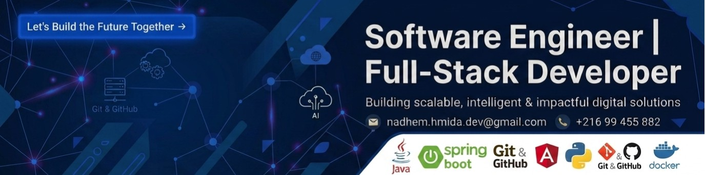
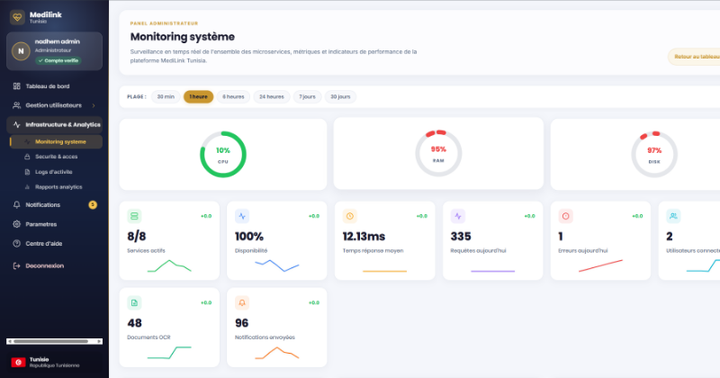
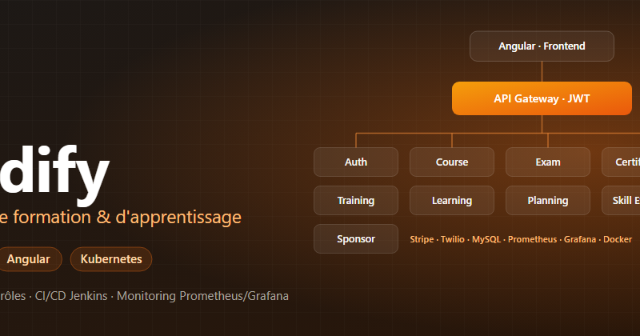
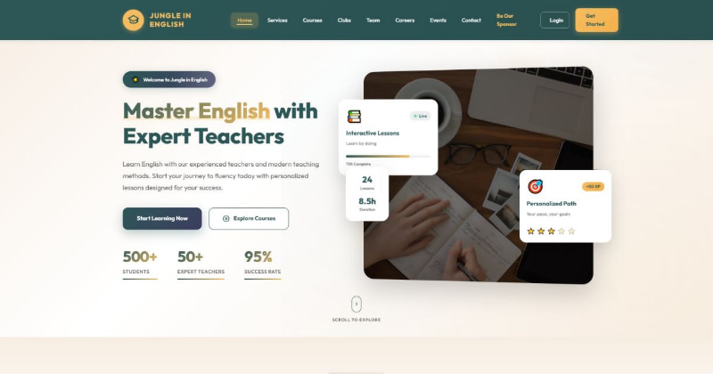
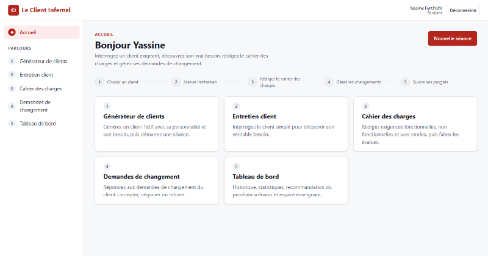
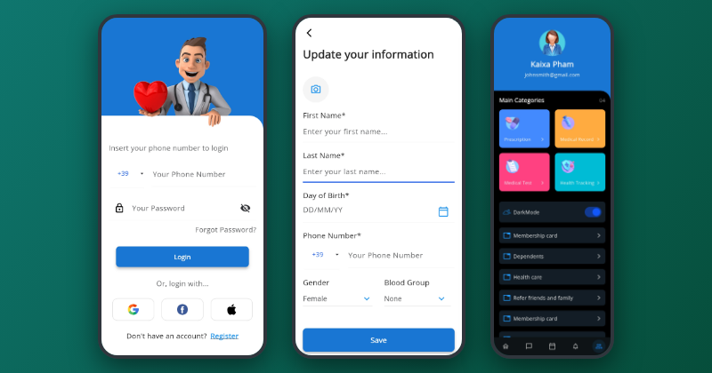
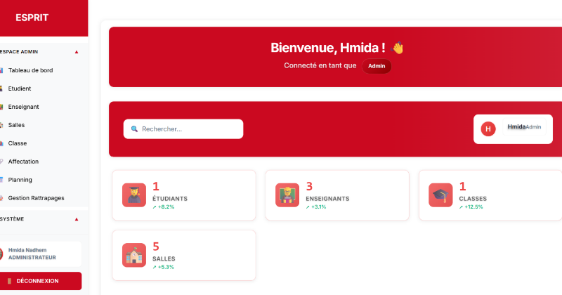

  

  

  
  
  

---

## 👋 About me

Software engineering student at **ESPRIT** (Tunis, 2022 – 2027), I design and build full-stack products end to end — from distributed back-ends to polished web and mobile interfaces, with AI where it adds real value.

- 🏗️ **Back-end** — microservices with Spring Boot & Spring Cloud (Gateway, Eureka, Config Server, Resilience4j)
- 🎨 **Front-end & mobile** — Angular, React, React Native and Flutter
- 🤖 **Applied AI** — RAG pipelines, OCR, LLM assistants (Gemini, Claude, OpenAI, Ollama)
- 🚢 **DevOps** — Docker, Kubernetes, Jenkins, Prometheus & Grafana
- 🎯 **Looking for** a final-year internship (PFE) or a software engineering role in Europe

---

## 💼 Experience

<table>
  <tr>
    <td width="90" align="center"></td>
    <td>
      <b>Engineering Intern · AMC Ernst &amp; Young</b> &nbsp;Jun 2026 – Jul 2026 
      Designed and built <b>MediLink Tunisia</b>, an e-health platform connecting patients, doctors and pharmacies — 10 microservices (Spring Boot + FastAPI), Angular web app and React Native mobile app. 
      📈 <b>90 %</b> OCR accuracy on lab reports · <b>−50 %</b> information search time with a RAG assistant · <b>99 %</b> availability monitored with Prometheus/Grafana
    </td>
  </tr>
  <tr>
    <td width="90" align="center"></td>
    <td>
      <b>Engineering Intern · ESPRIT</b> &nbsp;Jul 2025 – Aug 2025 
      Scheduling and room-booking platform with automatic timetable generation, powered by a constraint-satisfaction (CSP) engine. 
      📈 <b>−80 %</b> booking conflicts · <b>−70 %</b> manual scheduling time
    </td>
  </tr>
</table>

---

## 🚀 Featured projects

<table>
  <tr>
    <td width="50%" valign="top">
      
      <h3><a href="https://github.com/nadhem73/Medilink">MediLink Tunisia</a></h3>
      Connected healthcare platform: medical records, e-prescriptions, lab-report OCR and a RAG medical assistant.  
      <code>Spring Cloud</code> <code>FastAPI</code> <code>Angular</code> <code>React Native</code> <code>ChromaDB</code>
    </td>
    <td width="50%" valign="top">
      
      <h3><a href="https://github.com/nadhem73/Acadify">Acadify</a></h3>
      Training management platform on 11 microservices: courses, exams, digital certifications, Stripe payments and Twilio SMS.  
      <code>Spring Cloud</code> <code>Angular</code> <code>MySQL</code> <code>Kubernetes</code> <code>Jenkins</code>
    </td>
  </tr>
  <tr>
    <td width="50%" valign="top">
      
      <h3><a href="https://github.com/nadhem73/jungle-in-english">EnglishFlow</a></h3>
      English e-learning platform on 7 microservices: CEFR exams, real-time messaging, WebRTC video, OAuth2 and 2FA.  
      <code>Spring Boot</code> <code>Angular</code> <code>FastAPI</code> <code>WebRTC</code>
    </td>
    <td width="50%" valign="top">
      
      <h3><a href="https://github.com/Khaalilabd/le-client-infernal">Le Client Infernal</a></h3>
      AI platform for practising requirements elicitation with an LLM-simulated client (team of 5).  
      <code>React</code> <code>Node.js</code> <code>PostgreSQL</code> <code>Prisma</code> <code>LLM</code>
    </td>
  </tr>
  <tr>
    <td width="50%" valign="top">
      
      <h3><a href="https://github.com/nadhem73/Projet-mobile">MediLink Mobile</a></h3>
      Flutter app for the patient care pathway with lab-report OCR and a voice-driven LLM assistant.  
      <code>Flutter</code> <code>Dart</code> <code>SQLite</code> <code>MobX</code> <code>ML Kit</code>
    </td>
    <td width="50%" valign="top">
      
      <h3><a href="https://github.com/nadhem73/Systeme-de-reservation-et-de-planification-des-salles-d-universite">Room Planning System</a></h3>
      University room booking and automatic timetable generation with conflict detection.  
      <code>Spring Boot</code> <code>React</code> <code>PostgreSQL</code>
    </td>
  </tr>
</table>

➡️ More screenshots and details on my <a href="https://nadhem73.github.io/portfolio/"><b>portfolio</b></a>

---

## 🛠️ Tech stack

<table>
  <tr>
    <td><b>Languages</b></td>
    <td></td>
  </tr>
  <tr>
    <td><b>Back-end</b></td>
    <td></td>
  </tr>
  <tr>
    <td><b>Front-end &amp; mobile</b></td>
    <td></td>
  </tr>
  <tr>
    <td><b>Databases</b></td>
    <td></td>
  </tr>
  <tr>
    <td><b>DevOps &amp; tools</b></td>
    <td></td>
  </tr>
  <tr>
    <td><b>AI</b></td>
    <td>RAG · LLM APIs (Gemini, Claude, OpenAI) · Ollama · OCR (Tesseract, ML Kit) · ChromaDB · Prompt engineering</td>
  </tr>
</table>

---

## 🏆 Certifications

  
  
  
  
  

**🌍 Languages** — Arabic (native) · French (full professional) · English (full professional)

---

## 📊 GitHub activity

  <picture>
    <source media="(prefers-color-scheme: dark)" srcset="https://github-profile-summary-cards.vercel.app/api/cards/stats?username=nadhem73&theme=github_dark">
    
  </picture>
  <picture>
    <source media="(prefers-color-scheme: dark)" srcset="https://github-profile-summary-cards.vercel.app/api/cards/most-commit-language?username=nadhem73&theme=github_dark">
    
  </picture>

  

---

  <b>Let's build something great together.</b> 
  <a href="mailto:nadhem.hmida.dev@gmail.com">nadhem.hmida.dev@gmail.com</a> · <a href="https://www.linkedin.com/in/hmida-nadhem">LinkedIn</a> · <a href="https://nadhem73.github.io/portfolio/">Portfolio</a>

